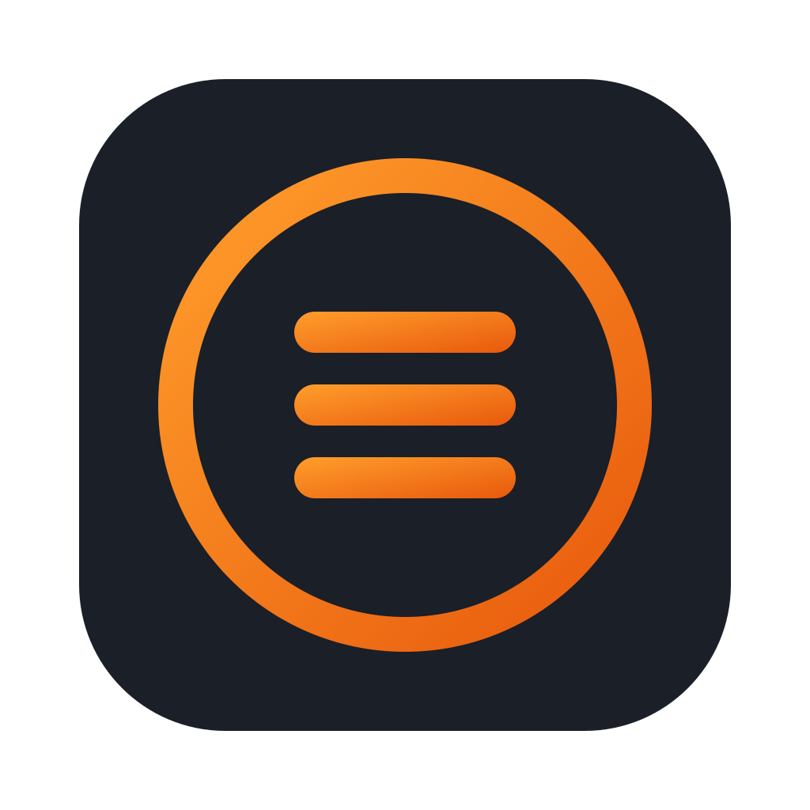

<h1 align="center">
  <br>
  Vassago
</h1>

<p align="center">
  <a href="https://github.com/quyennguyenvu/vassago/releases"></a>
  
  
</p>

A clipboard history for macOS. Copy several things in one place, then paste each of them somewhere else without going back for the next one. A hotkey opens the history at the mouse pointer, and one more key pastes the item you pick. The idea comes from Ditto on Windows. Swift, no dependencies, local only: no account, no telemetry.

## Why Vassago

**Copy many, then paste many.** A page lists five order codes and each needs its own browser tab. Copy all five, then in each tab press ⌃⌥V (Control + Option + V) and a digit. No switching back for the next code.

**The list never takes your cursor.** It is an ordinary macOS menu, so the app you are pasting into keeps the keyboard focus and the paste lands where you were typing.

**Text, images and files.** Text keeps its formatting, screenshots show a thumbnail, and copied files paste as files. The history survives a restart.

**It skips secrets.** Anything a password manager marks as concealed, as KeePassXC and 1Password do, is never recorded.

**Small and local.** About 1,300 lines of Swift with no third-party code. The only network request Vassago ever makes asks GitHub for the latest release number, at most once a day and when you choose Check for Updates. Nothing you copy leaves your Mac.

In the Ars Goetia, Vassago is the prince "of the same nature as Agares" whose office is "to declare things past and to come, and to discover all things hid or lost".

## Install

Grab the `.dmg` from the [Releases page](https://github.com/quyennguyenvu/vassago/releases). One file runs on both Apple Silicon and Intel Macs, macOS 13 or newer.

Vassago isn't signed with a paid Apple certificate (it's a personal project), so macOS blocks the **first** launch with a warning. The warning only means the developer didn't buy a certificate. Allow it once and it never appears again.

1. Open the `.dmg` and drag **Vassago** onto **Applications**.
2. Open **Vassago** from Applications. macOS says **"Apple could not verify 'Vassago' is free of malware"**.
3. **Click "Done", not "Move to Trash".** Move to Trash is the highlighted button, and it deletes the app.
4. Allow it once, using either method below, then open Vassago again.
5. Switch Vassago on under **System Settings → Privacy & Security → Accessibility**. Vassago opens its panel with a button that takes you there. It needs this permission to press Command+V for you when you pick a clip.

**Without Terminal.** Open **System Settings → Privacy & Security** and scroll to the **Security** section. Click **Open Anyway** and confirm with Touch ID or your password.

**With Terminal.**

```sh
xattr -dr com.apple.quarantine /Applications/Vassago.app
```

> Right-click → **Open** used to work here. Apple removed it in macOS 15.

### Permissions

| Permission | Where | Why |
| --- | --- | --- |
| Accessibility | **Privacy & Security → Accessibility → Vassago** | Vassago presses Command+V for you when you pick a clip. Without it, a pick only puts the clip on the clipboard. |
| Clipboard access | Usually nothing to do | Vassago reads the clipboard each time you copy. On macOS 27.2 it is allowed to without asking. If macOS does ask, or the menu bar shows `⚠`, choose **Always Allow** for Vassago under **Privacy & Security → Paste from Other Apps**. |

### Updating

Vassago tells you when a newer version exists. Once a day it asks GitHub for the latest release; if there is one, a dot appears on the menu bar item, the menu gains a **Version … Available…** item, and the panel shows a **Get …** button. Each opens the release page. Vassago never downloads or installs anything itself.

Replace the app in Applications with the newer version. Every release is signed with the same certificate, so the Accessibility permission carries over.

### Checking the download is genuine (optional)

Every release ships a `SHA256SUMS.txt`, and the installer carries a GitHub [build-provenance attestation][provenance].

```sh
# the file matches the published checksum
shasum -a 256 -c SHA256SUMS.txt --ignore-missing

# ...and it really came out of this repo's release workflow
gh attestation verify Vassago-<version>.dmg --repo quyennguyenvu/vassago
```

[provenance]: https://docs.github.com/actions/security-guides/using-artifact-attestations-to-establish-provenance-for-builds

## Using it

- **Open the list** with ⌃⌥V. Digits 1 to 9 paste the nine newest clips; the arrow keys and Enter, or a click, reach the rest. Esc closes it.
- **The menu bar item** shows the nine newest clips too, for the mouse.
- **Open the panel** from the menu bar item, or by opening Vassago again from Launchpad or Spotlight. It holds the on/off switch, the hotkey, the whole history, Launch at login and Check for Updates. A click on a row copies it back; the × deletes it.
- **Change the hotkey** with **Record…** in the panel. It must include Control, Option or Command.
- **Vassago lives in the menu bar.** Its Dock icon is there only while the panel is open.
- **Closing the panel does not quit Vassago**, and neither do ⌘Q or the Dock's Quit. To quit, click the menu bar item and choose **Quit Vassago**.

### Good to know

- **The history is kept on your disk, not encrypted,** under `~/Library/Application Support/Vassago`, readable only by your account. A password copied from an app that does not mark it as concealed is saved like any other text. Delete it with the × in the panel, or clear everything with **Clear All**.
- **100 clips or 200 MB**, whichever comes first. The oldest clips make room for new ones. A single copy over 20 MB is not kept.
- **Pasting does not reorder the list,** so the numbers stay put while you work through a run of clips.
- **Copying the same thing again** moves it to the top instead of adding a second row.
- **Files are remembered by location.** If a file has moved or been deleted, its clip pastes nothing.
- **Images are kept as PNG.**
- **What you copy on your iPhone** and paste on the Mac through Universal Clipboard is not recorded.
- **Two copies within a third of a second** record only the second.

### If something looks off

- **`⚠` in the menu bar:** Vassago is not allowed to read the clipboard, so nothing is being recorded. Open the panel and press **Allow Clipboard Access…**, then choose **Always Allow** for Vassago.
- **Picking a clip copies but does not paste:** Accessibility is missing. Open the panel and press **Grant Accessibility…**. If Vassago is already switched on there, macOS is holding a permission from an older build: press **Reset Permission** instead, then switch it on again.
- **The hotkey does nothing:** another app may own that shortcut. Record a different one in the panel.

## Developing

You need macOS 13 or newer, a Swift 6 toolchain (the Command Line Tools are enough, no Xcode), and `librsvg` for the icon (`brew install librsvg`).

```sh
bash scripts/test.sh             # run the tests
bash scripts/bundle.sh install   # build, sign, copy to /Applications and launch
```

Builds are signed with the self-signed "Agares Dev" certificate, the one [Agares](https://github.com/quyennguyenvu/agares) uses, so the Accessibility permission survives every rebuild. Create it once with `scripts/make-cert.sh` from the Agares repository. Releases use that same certificate; a certificate you create yourself is a different signer, so your builds and the released ones do not share a permission.

### Releasing

```sh
scripts/release.sh 0.2.0            # test, bump Resources/Info.plist, commit, tag, push
scripts/release.sh 0.2.0 --dry-run  # show what it would do
```

Pushing the `v0.2.0` tag starts `.github/workflows/release.yml`, which re-runs the tests, builds a universal app, signs it with the "Agares Dev" certificate, packages `Vassago-0.2.0.dmg`, attaches a provenance attestation and `SHA256SUMS.txt`, and publishes the GitHub release with `.github/release-body.md` on top of the generated notes. Tags are always `v` plus three numbers; the in-app update check ignores anything else.

The workflow reads the certificate from two repository secrets, `SIGNING_P12_BASE64` and `SIGNING_P12_PASSWORD`, set once under **Settings → Secrets and variables → Actions**. They hold the same values as in the Agares repository, whose README shows how to export them. The workflow refuses to publish a build whose signer is not that exact certificate.

### Layout

| Path | What lives there |
| --- | --- |
| `Sources/VassagoEngine` | Pure logic with no imports: the history and its limits, the hotkey rules, version comparison |
| `Sources/Vassago` | The app: clipboard watcher, files on disk, hotkey, the list, menu bar item, panel, update check |
| `Tests/VassagoEngineTests` | Unit tests for everything in the engine |
| `scripts` | Test, bundle and release scripts |
| `docs/superpowers` | Design spec and implementation plan |

If `swift build` fails with `Invalid manifest` and `Undefined symbols … swiftLanguageVersions`, the Command Line Tools contain leftover files from an older Swift. Remove them with `sudo find /Library/Developer/CommandLineTools/usr/lib/swift/pm -name '*.private.swiftinterface' -delete`.
